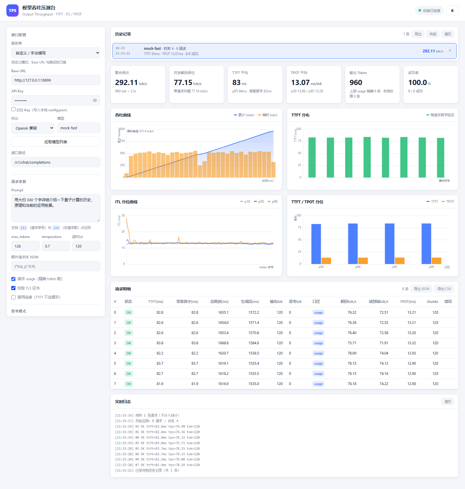

# 压测模型的 token 吞吐力

压测大模型接口的**输出吞吐能力**。浏览器端出图，服务端做计时。



测的是**输出侧**吞吐——模型每秒能吐多少 token，以及在并发下这个数字怎么变。

## 特性

- **六项核心指标**：聚合吞吐、并发解码吞吐、TTFT、TPOT、输出 token、成功率
- **四张图表**：吞吐曲线（累计 token + 瞬时 tok/s）、TTFT 分布、ITL 分位曲线（p10/p50/p90）、TTFT/TPOT 分位对比
- **31 个服务商预设**：小米 MiMo / DeepSeek / LongCat / GLM / Qwen / Claude / Gemini / OpenAI / Kimi / 豆包 / 硅基流动 / 千帆 / 混元 / Groq 等，选完自动填好接入点，不用记路径
- **思考模式支持**：开关 + 思考级别，按各家官方参数格式自动翻译（OpenAI / Claude / DeepSeek / GLM / Qwen / Gemini / MiMo / LongCat 八种风格）
- **思考 token 单独统计**：思维链走 `reasoning_content`，计入吞吐但不算答案；TTFT 与「答案首字延迟」分开报
- **历史记录**：每次压测自动存档到本地，点开即可回看全部指标与图表，支持导出 CSV 做横向对比
- **图表可交互**：四张图悬停出 tooltip，点击可固定；点 TTFT 柱子直接定位到明细表对应行
- **一键拉取模型列表**：后端代理调上游 `/models`，模型名也不用记
- **Token 口径透明**：每条请求都标明 token 是上游 `usage` 精确值还是本地估算；空 chunk 一律过滤，空帧不会污染 TTFT
- **并发梯度压测**：调并发数看吞吐何时饱和、TTFT 何时开始劣化
- **双协议**：OpenAI 兼容（vLLM / Ollama / LM Studio / 硅基流动 / DeepSeek…）+ Anthropic Messages
- **实时反馈**：每条请求完成即推送，不用等整轮结束
- **零第三方依赖**：Python 标准库即可运行，图表原生 Canvas 手绘，无 CDN
- **深浅双主题**，响应式，手机可用
- 结果导出 JSON / CSV

## 快速开始

```bash
git clone https://github.com/2642086672/llm-token-throughput-tester.git
cd llm-token-throughput-tester
python server.py --host 127.0.0.1 --port 8770
```

浏览器打开 <http://127.0.0.1:8770> ，填 Base URL、路径、模型名、API Key，点「开始压测」。

Python 3.8+，无第三方依赖。

### 不想用真实 Key？本地自测

开两个终端：

```bash
# 终端 1：mock 上游，模拟 ttft=80ms、每 token 间隔 12ms、共 120 token
python mock/mock_server.py --port 18899 --ttft 80 --itl 12 --tokens 120

# 终端 2：压测后端
python server.py --port 8770
```

页面上填 Base URL `http://127.0.0.1:18899`、路径 `/v1/chat/completions`、模型 `mock-fast`、Key 随意填，总请求数 `8`、并发 `4`。

**预期结果**：TTFT ≈ 83ms，解码速率 ≈ 77.5 tok/s（= 1000/12ms − 首字开销），成功率 100%。

## 为什么计时放服务端

浏览器 `fetch` 读 SSE 的时间戳受主线程渲染、GC、后台标签页节流影响，误差能到几十毫秒——而 TTFT 本身也就几十毫秒。放到服务端用 `time.perf_counter()` 逐 chunk 打点，精度是微秒级。顺带解决 CORS：直连 `api.openai.com` 会被浏览器拦掉。

## 目录结构

```
llm-token-throughput-tester/
├── server.py              压测后端：SSE 代理 + 计时 + 统计聚合 + 静态托管
├── thinking.py            思考模式参数映射：各家 wire 格式的翻译层
├── config.json            默认配置（前端「保存配置」写入，原子替换）
├── static/
│   ├── index.html         前端页面
│   ├── style.css          样式（含深色主题）
│   ├── app.js             前端逻辑：表单绑定、SSE 消费、Canvas 图表
│   ├── history.js         历史记录存储：降采样、增删查、还原
│   └── chart.js           图表交互层：命中测试、tooltip、选中态
├── mock/
│   ├── mock_server.py      模拟 OpenAI 兼容流式接口，本地自测用
│   ├── mock_edge_cases.py  发「脏 chunk」（空串/null/空对象/空格），验证过滤逻辑
│   ├── mock_no_usage.py    只发内容不发 usage，验证本地估算路径
│   └── mock_thinking.py    先吐思维链再吐答案，验证思考模式统计
├── test_thinking.py       思考参数映射单元测试（标准库即可跑）
├── e2e_test.js            Playwright 端到端验收脚本（开发用，非运行必需）
└── README.md
```

> `e2e_test.js` 是开发期的端到端验收脚本，依赖 `playwright-core` 与本机 Edge/Chrome，**运行本工具本身不需要它**。

## 依赖

Python 3.8+，**零第三方依赖**，标准库即可。

可选：装 `tiktoken` 后 token 计数更准（`pip install tiktoken`）。没装时退化为启发式估算（CJK 1 字≈1 token，ASCII 4 字符≈1 token），结果里会标 `estimated`；上游给了 `usage` 就用精确值。

```bash
pip install tiktoken   # 可选
```

## 启动

```bash
cd llm-token-throughput-tester

# 压测后端
python server.py --host 127.0.0.1 --port 8770

# 浏览器打开
# http://127.0.0.1:8770
```

参数：

| 参数 | 默认 | 说明 |
|---|---|---|
| `--host` | `127.0.0.1` | 监听地址。局域网内别人访问用 `0.0.0.0` |
| `--port` | `8770` | 监听端口 |
| `--config` | `./config.json` | 配置文件路径 |

## 本地自测（不需要真实 API Key）

见上文「快速开始 → 不想用真实 Key？本地自测」。

## 指标口径

| 指标 | 公式 | 说明 |
|---|---|---|
| TTFT | 首 chunk 时间 − 请求发起时间 | 首 token 延迟 |
| TPOT | 生成段时长 ÷ (输出 token − 1) | 每 token 平均生成间隔 |
| ITL | 相邻 chunk 时间差 | 逐 token 间隔，比 TPOT 细，能看抖动 |
| 解码吞吐 | 输出 token ÷ 生成段时长 | 排除 TTFT 的纯生成速率 |
| 端到端吞吐 | 输出 token ÷ 总耗时 | 含首字延迟 |
| **聚合吞吐** | 总输出 token ÷ 墙钟时长 | **多并发下系统整体吐字速率，核心指标** |
| 并发解码吞吐 | 总输出 token ÷ 各请求生成段之和 | 并发流量的平均速率 |

单请求 TTFT 里是否含 TCP/TLS 握手，取决于「复用连接」开关：

- 关（默认）：每次新建连接，TTFT 含握手，贴近真实用户的首次调用体验
- 开：连接常驻，TTFT 只反映服务端排队 + 首字计算，反映服务本身的处理能力

## Token 计数口径

工具只有两种口径，每条请求明细都带 `token_source` 字段标明用了哪种：

| 口径 | 条件 | 来源 |
|---|---|---|
| `usage` | 勾了「请求 usage」**且**上游返回了 usage | 上游 `completion_tokens`，精确值 |
| `estimated` | 其余情况 | 本地计算（见下） |

本地估算优先级：装了 `tiktoken` 就用 `cl100k_base` 精确编码；没装则用启发式（CJK 1 字 ≈ 1 token，其余 4 字符 ≈ 1 token）。

**注意**：勾选「请求 usage」只影响"要不要向上游索要"这个动作。若上游忽略该参数返回了 usage，工具**仍会采信**上游值——因为上游给的数就是准的。反过来，取消勾选后工具会**改用本地估算**，即使上游仍返回了 usage 也不采信，这样口径与你的设置始终一致。

### 空 chunk 的处理

SSE 流里常见的空帧会被过滤，**不计入 token、不参与 ITL 统计、不影响 TTFT**：

| 上游发的帧 | 处理 |
|---|---|
| `{"delta":{"role":"assistant","content":""}}` | 丢弃（content 为空串） |
| `{"delta":{"content":null}}` | 丢弃（content 为 null） |
| `{"delta":{}}` | 丢弃（无 content 字段） |
| `{"choices":[],"usage":{...}}` | 只取 usage，不算 chunk |
| `data: [DONE]` | 结束标记 |
| `: ping` 注释行 | 丢弃 |
| `{"delta":{"content":" "}}` | **保留**（空格是真实字符，算 1 token） |

关键点：**空帧不会提前触发 TTFT**。TTFT 只在收到第一个非空 content 时打点，所以「先发 role 再发内容」这种两段式响应，测出来的 TTFT 是内容真正开始的时间，不是 role 帧的时间。

**空格帧保留是有意为之**——它是一枚真实的 token，把它算进去才能让 ITL 序列与上游实际吐字节奏对齐。如果全滤掉，ITL 会出现虚假的间隔跳变。

`chunks` 字段是**有效 chunk 数**（过滤后），ITL 长度 = chunks − 1。

## 服务商预设

页面顶部的「服务商」下拉内置 **15 组 31 个接入点**，选完自动填好 Base URL、接口路径、协议和默认模型——不用记任何路径。

| 分组 | 预设 | Base URL | 接口路径 | 协议 |
|---|---|---|---|---|
| 小米 | MiMo 按量付费 | `https://api.xiaomimimo.com/v1` | `/chat/completions` | OpenAI |
| 小米 | MiMo 按量付费 | `https://api.xiaomimimo.com/anthropic` | `/v1/messages` | Anthropic |
| 小米 | MiMo Token Plan | `https://token-plan-cn.xiaomimimo.com/v1` | `/chat/completions` | OpenAI |
| 小米 | MiMo Token Plan | `https://token-plan-cn.xiaomimimo.com/anthropic` | `/v1/messages` | Anthropic |
| DeepSeek | 官方 | `https://api.deepseek.com` | `/v1/chat/completions` | OpenAI |
| DeepSeek | Reasoner | `https://api.deepseek.com` | `/v1/chat/completions` | OpenAI |
| LongCat | 美团官方 | `https://api.longcat.chat/openai` | `/v1/chat/completions` | OpenAI |
| LongCat | 美团官方 | `https://api.longcat.chat/anthropic` | `/v1/messages` | Anthropic |
| GLM | 智谱开放平台 | `https://open.bigmodel.cn/api/paas/v4` | `/chat/completions` | OpenAI |
| GLM | Z.AI 国际站 | `https://api.z.ai/v1` | `/chat/completions` | OpenAI |
| Qwen | 百炼国内 | `https://dashscope.aliyuncs.com/compatible-mode/v1` | `/chat/completions` | OpenAI |
| Qwen | 百炼国际 | `https://dashscope-intl.aliyuncs.com/compatible-mode/v1` | `/chat/completions` | OpenAI |
| Claude | Anthropic 官方 | `https://api.anthropic.com` | `/v1/messages` | Anthropic |
| Gemini | Google AI Studio | `https://generativelanguage.googleapis.com/v1beta/openai/` | `/chat/completions` | OpenAI |
| OpenAI | 官方 | `https://api.openai.com/v1` | `/chat/completions` | OpenAI |
| Kimi | 月之暗面 | `https://api.moonshot.cn/v1` | `/chat/completions` | OpenAI |
| 豆包 | 火山方舟 | `https://ark.cn-beijing.volces.com/api/v3` | `/chat/completions` | OpenAI |
| 硅基流动 | 官方 | `https://api.siliconflow.cn/v1` | `/chat/completions` | OpenAI |
| 百度千帆 | v2 | `https://qianfan.baidubce.com/v2` | `/chat/completions` | OpenAI |
| 腾讯混元 | 官方 | `https://hunyuan.cloud.tencent.com/v1` | `/chat/completions` | OpenAI |
| 海外聚合 | Groq / OpenRouter / Together / Mistral | 各自地址 | `/chat/completions` | OpenAI |
| 本地部署 | vLLM / Ollama / LM Studio / Xinference / llama.cpp | `127.0.0.1:8000/11434/1234/9997/8080` | `/chat/completions` | OpenAI |

几点说明：

- **小米 / LongCat 是双协议**，同一个服务商给 OpenAI 和 Anthropic 两个接入点，选哪个就走哪种解析
- **小米是唯一有「按量付费」和「Token Plan 订阅」两套地址的服务商**——Token Plan 用 `token-plan-cn.xiaomimimo.com`，Key 前缀是 `tp-`（团队版 `ttp-`），与按量付费的 `sk-` 不通用
- **本地部署的预设不填默认模型名**，因为模型由你本地起了什么决定——选完直接点「拉取模型列表」
- 手动改 Base URL 或路径后，下拉自动跳到「自定义 / 手动填写」，避免显示的预设与实际配置对不上

## 拉取模型列表

模型名同样不用记。填好接入点后点「**拉取模型列表**」，后端代理调一次上游 `/models`，把返回的模型 ID 塞进模型输入框的联想下拉。

模型路径由你填的接口路径自动推导：

```
/v1/chat/completions          →  /v1/models
/openai/v1/chat/completions   →  /openai/v1/models
/chat/completions             →  /models
/v1/messages                  →  /v1/models
```

三种返回结构都能解析：`{"data":[{"id":...}]}`、`{"data":[{"model_name":...}]}`、`{"models":[...]}`。

本地 vLLM / Ollama 走这条路最省事——`http://127.0.0.1:11434/v1` 拉一下就知道当前装了哪些模型。

## 思考模式

页面上有独立的「思考模式」区块：**开关**（模型默认 / 开启 / 关闭）+ **思考级别**。选服务商预设时会自动切到对应的参数风格，也可以手动改。

各家的思考参数写法完全不同，工具按服务商翻译成对应的 wire 格式（下表均已核对官方文档）：

| 参数风格 | 对应服务商 | 实际发出的参数 | 支持的级别 |
|---|---|---|---|
| OpenAI | OpenAI、硅基流动、千帆、混元、海外聚合、本地部署 | `reasoning.effort` | none / minimal / low / medium / high / xhigh |
| Claude | Claude | `thinking.type=adaptive` + `output_config.effort` | low / medium / high / xhigh / max |
| DeepSeek | DeepSeek | `thinking.type` + `reasoning_effort` | low / high / max |
| GLM | 智谱 GLM | `thinking.type` + `reasoning_effort` | none / minimal / low / medium / high / xhigh / max |
| Qwen | Qwen、Kimi、豆包 | `enable_thinking` + `reasoning_effort` 或 `thinking_budget` | low / medium / xhigh |
| Gemini | Gemini | `google.thinking_config.thinking_level` + `include_thoughts` | minimal / low / medium / high |
| MiMo | 小米 | `thinking.type` | 无档位（仅开关） |
| LongCat | LongCat 美团 | `thinking.type` + `thinking_budget` | 无档位（token 预算） |

几个坑：

- **OpenAI 没有独立的思考开关**，`reasoning.effort=none` 就是关闭
- **小米 MiMo 只有开关没有档位**——文档明确写了只支持 `thinking.type` 的 enabled/disabled，选了档位会被忽略，页面会提示
- **Qwen3.8 系列不允许 `reasoning_effort` 与 `thinking_budget` 同时设置**，工具按优先级只发其中一个
- **Claude 老的 `budget_tokens` 方式在新模型上会 400**，现在用 `thinking.type=adaptive` + `output_config.effort`
- **DeepSeek 思考模式下 temperature / top_p 不生效**（不会报错，但会被忽略）
- **GLM 的 `none` 和 `minimal` 会让模型放弃思考**，`low` / `medium` 映射为 `high`，`xhigh` 映射为 `max`

### 思考 token 单独统计

思考模式有个容易算错的地方：模型的思维链走 `reasoning_content` 字段，**不在 `content` 里**，但**照样计入输出 token 和计费**。

工具的处理：

- 思维链增量计入 `chunks`——它参与了吞吐曲线和 ITL 统计，那才是真实的吐字节奏
- 思维链**不进答案文本**，探针弹窗显示的仍是最终答案
- 思考 token 数从上游 `usage.completion_tokens_details.reasoning_tokens` 读，读不到就用本地估算
- 明细表「思考tok」列用紫色标签单独标出

### TTFT 与答案首字延迟

**思考模式下这两个数必须分开看**：

- **TTFT** = 首个输出 token 的时间。思考模式下这就是思维链的第一帧，往往只有几毫秒
- **答案首字** = 用户真正看到第一个字的���间。思维链走完才开始出答案

实测差距能到两个数量级——TTFT 显示 1ms 但答案首字 127ms。只看 TTFT 会严重低估体感延迟。表格里两列都有，KPI 副标也会在有思考内容时同时显示。

## 协议支持

**OpenAI 兼容**（`/v1/chat/completions` 等）——上面预设表里除 Claude 外全部走这套。

**Anthropic Messages**（`/v1/messages`）——协议下拉切换，路径自动改成 `/v1/messages`。

部分网关不支持 `stream_options`，后端遇到 400 会自动去掉重试一次。

## 配置说明

| 字段 | 含义 |
|---|---|
| Base URL | 根地址，不含接口路径 |
| 路径 | 完整接口路径，OpenAI 兼容一般 `/v1/chat/completions` |
| Prompt | 支持 `{i}`（请求序号）、`{n}`（总请求数）占位符 |
| max_tokens | 每次请求的输出上限，**直接决定压测时长** |
| 额外请求体 JSON | 追加字段，如 `{"top_p":0.9,"stop":["\n"]}` |
| 请求 usage | OpenAI 兼容下请求返回 token 统计，拿到就是精确值 |
| 校验 TLS 证书 | 自签名证书的本地服务要关掉 |
| 复用连接 | 见上文 TTFT 口径说明 |
| 预热 | 先跑 N 条不计入统计，把连接建立、TLS 握手、首次 JIT 等一次性开销挪出去 |
| 曲线采样桶 | 吞吐曲线的时间粒度，默认 100ms |
| 思考参数风格 | 决定思考参数怎么写，见「思考模式」章节 |
| 思考开关 | 三态：模型默认（不下发）/ 开启 / 关闭 |
| 思考级别 | 强度档位，可选值由服务商决定 |
| 思考 token 预算 | 只有 Qwen 与 LongCat 用，其余服务商忽略 |

**API Key 默认不落盘**。只有勾了「记住 Key」才会写进 `config.json`（本机文件，注意 `config.json` 别进版本库）。

## 历史记录

每次压测结束后，结果自动存进浏览器本地（localStorage），页面顶部就是历史列表。

- **点任意一条即可回看**——KPI、四张图、明细表全部回到那次的状态，当前查看的那条会高亮
- 每条显示：时间、模型、并发数、请求数、TTFT、TPOT、成功率、聚合吞吐
- 单条删除（✕）或一键清空，也可以折叠起来不占地方
- 「导出」把全部历史导成 CSV，方便拿进 Excel 做横向对比
- 刷新页面、关掉浏览器再打开，历史都还在

**存储是有上限的**，所以存的时候会降采样：

| 内容 | 原始 | 存储时 |
|---|---|---|
| 吞吐曲线 | 最多 800 点 | 150 点 |
| ITL 分位曲线 | 最多 200 点 | 100 点 |
| 请求明细 | 全部 | 200 条 |
| 历史条数 | — | 50 条 |

单条约 12KB，50 条 600KB，localStorage 一般有 5MB，够用。写入失败（比如隐私模式禁用了存储）不会影响压测本身，只是历史存不下来。

## 图表交互

四张图都能交互，不用只看静态图：

| 图表 | 悬停 | 点击 |
|---|---|---|
| 吞吐曲线 | 显示该时刻的累计 token、瞬时 tok/s、本桶 token | 固定该点（画参考线 + 数据点） |
| TTFT 分布 | 显示该请求的 TTFT、答案首字、总耗时、解码速率、思考 token | 选中该请求，**自动在明细表里定位并高亮对应行** |
| ITL 分位曲线 | 显示该 token 序号的 p10/p50/p90，以及抖动幅度 p90−p50 | 固定该位置 |
| TTFT/TPOT 分位 | 显示该分位的两个值与倍数关系 | 固定该分位组 |

选中态用描边表达，不用填充色——填充色已经承担了"正常/离群"的语义，混用会看错。

点击 TTFT 图的柱子能直接跳到明细表对应行，是排查单条慢请求最快的路径。

## 页面功能

- 6 张 KPI 卡：聚合吞吐、并发解码吞吐、TTFT 均值、TPOT 均值、输出 token、成功率
- 4 张图表：吞吐曲线（累计 token + 瞬时 tok/s）、TTFT 分布、ITL 分位曲线（p10/p50/p90）、TTFT/TPOT 分位对比，均可交互
- 31 个服务商预设：选完自动填好 Base URL、接口路径、协议、模型、思考参数风格
- 思考模式面板：开关 + 思考级别，按各家官方格式自动翻译
- 历史记录：每次压测自动存档，点开即可回看，支持导出 CSV
- 请求明细表：每条请求的完整计时，含思考 token 数与答案首字延迟
- 实时日志：逐条请求到达即打印
- 导出 JSON / CSV
- 单次探测：弹窗看原文 + 计时，不跑压测
- 深浅色主题，响应式（手机可用）

## 怎么读结果

**聚合吞吐**是主指标，它随并发数变化：

- 并发从 1 提到 N，聚合吞吐应大致线性上升
- 涨不动了 → 服务端已经饱和，瓶颈在推理算力或限流
- 反而下降 → 出现排队堆积或超时

**TTFT 分位差**（p95 − p50）反映抖动。差值大说明服务端在抢占或被其他负载干扰。

**ITL p90 远高于 p50** 说明输出不稳定，逐 token 间隔忽快忽慢。

**先看「口径」列**。明细表里每行都标了这条请求的 token 是 `usage`（上游精确值）还是 `估算`（本地算的）：

- 全是 `usage` → 数字可以直接横向对比，可信度最高
- 出现 `估算` → token 数是本地推算的，**绝对值有偏差，但同一批次内横向比较仍然有效**（偏差对所有请求是同向的）
- 全部 `估算` 且你关心绝对值 → 装 `tiktoken` 提高精度，或确认上游支持 `stream_options.include_usage`

估算口径下**吞吐的相对趋势依然可信**——比如"并发从 1 到 8 吞吐涨了 4 倍"这个结论不会因为 token 计数有 5% 的系统性偏差而改变。

**思考模式下**重点看两个差值：

- **思考 token 占比** = 思考 tok ÷ 输出 tok。占比高说明模型把大部分算力花在推理上，答案本身很短
- **答案首字延迟 − TTFT** = 思维链耗时。思考级别调高时这个差值会明显拉长，而聚合吞吐可能几乎不变（服务端每 token 的生成速率是稳定的）

想对比不同思考级别的吞吐，就固定并发和 prompt，只改思考级别跑几轮——这是这个工具最实用的用法之一。

## 常见问题

**压测结果全失败**
先点「单次探测」看具体错误。连接被拒 → 服务没起或地址错；404 → 路径不对；401 → Key 无效。

**TTFT 特别大**
检查是不是没开「复用连接」——每次新建连接会多出握手时间。想测服务本身能力就打开。

**token 数不准**
没勾「请求 usage」时是估算值，结果里标 `estimated`。装 `tiktoken` 能提升估算精度。

**压测很慢**
`max_tokens` 越大越慢。测吞吐用 128~512 够了，测长文本能力再调大。

**中途想停**
点「停止」，用 AbortController 掐断 SSE 连接。

## 接口

| 方法 | 路径 | 说明 |
|---|---|---|
| GET | `/` | 前端页面 |
| GET | `/api/health` | 健康检查 |
| GET | `/api/config` | 读当前配置 |
| POST | `/api/config` | 写配置（原子替换） |
| POST | `/api/models` | 代理拉取上游 `/models`，路径由接口路径自动推导 |
| POST | `/api/probe` | 单次流式探测，SSE 返回 |
| POST | `/api/bench` | 并发压测，SSE 返回 |

压测的 SSE 事件类型：`phase`（阶段切换）、`progress`（单条请求完成）、`result`（最终聚合）、`error`、`done`。
